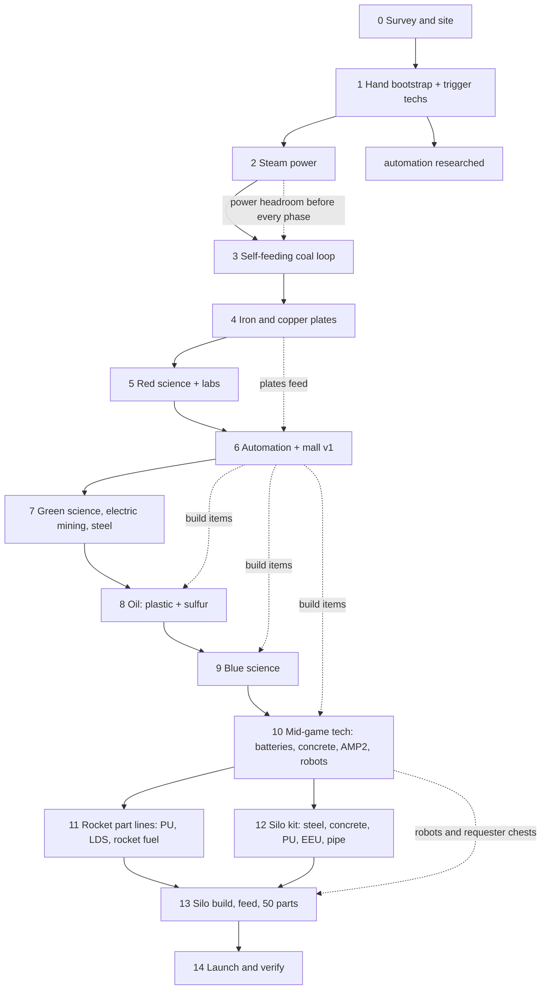

# Scratch to rocket: the conceptual build order

This skill is the **plan**, not the mechanics. It answers: what comes next, what blocks what, what can run in parallel, and when a phase is actually finished.

- Execution details (gqlcli, geometry, inserter/belt rules, diagnostics, engine traps, multi-agent): `../factorio-gameplay/SKILL.md` and its references.
- Live state and the live schema beat every number here. Re-derive tech costs with `researchInsights`, recipes with `recipe`/`billOfMaterials`, and rates with `production` before committing capacity.
- One run = one epic in `bd`; one phase = one ticket. Evidence goes on the ticket: tick, unit numbers, measured rate, the read that proved the gate.

The default target is a **verified rocket launch** on a fresh save. Space Age platform/space-science work is off the critical path unless the objective says otherwise. On an existing save, audit the gates below and start at the earliest unmet one; never rebuild a phase that already passes its gate.

## 1. The plan in one graph



Read it as a dependency graph, not a strict queue. Research runs continuously; construction runs on the next blocked node. A phase starts when its inputs exist, not when the previous phase's paperwork is finished.

## 2. Rules that govern the sequence

1. **Critical path first.** Deepest unfinished dependency wins: plates -> circuits -> oil -> blue -> PU/LDS/RF -> silo. Shorter tasks fill gaps while the long timer runs.
2. **A phase is done only at its gate.** Exit gates below are observable, not "machines placed". A placed machine is not a working cell; a mutation acknowledgement is not production.
3. **Producer and consumer ship together.** Every output needs a drained consumer and every buffer a bound; a full output halts the whole chain. Build the consumer before cloning the producer.
4. **One working slice, then clone.** Prove recipe, power, every input, every output, then duplicate. Never scale an unverified design.
5. **Automate every repeated action immediately after its first use.** Hand crafting/mining/loading is bootstrap only. A repeated manual action means a missing cell or mall item.
6. **Research never idles.** Queue the next legal technology before the current one finishes. Check `status.paused` and `speed` before calling a lab stalled.
7. **Power and fuel are part of every cell.** Generation >= 1.3x projected load; every burner entity gets an automated fuel path in the same build.
8. **Reserve space before you need it.** Record block bounds and one extension direction; leave bus lanes, crossings, and fluid corridors empty.
9. **Trigger technologies are actions, not research.** `steam-power`, `electronics`, `automation-science-pack`, `oil-processing` complete by doing the trigger; `startResearch` refuses them.
10. **Never advance on stock alone.** Pack stock in a chest without progress, a full belt, and a placed ghost are all not throughput.

## 3. Phase ladder

| # | Phase | Starts when | Deliverable | Exit gate (proof) |
|---|---|---|---|---|
| 0 | Survey | save exists | patch/site table, worker character, reserved corridors | iron+copper+coal+stone+water reachable; bounds recorded; worker `unitNumber` |
| 1 | Hand bootstrap | survey done | trigger techs, first lab, steam parts | `steam-power`, `electronics`, `automation-science-pack` researched; `automation` started |
| 2 | Steam power | bootstrap parts | pump -> boiler -> engine -> poles, bounded coal chest | production > 0 for >= 1800 ticks, no manual refuel |
| 3 | Coal loop | power | self-fuelling coal drills -> belt -> depot -> burners | no `no_fuel` for 1800 ticks; coal stock rises |
| 4 | Plates | coal loop | iron and copper drill->furnace pairs, belt to base | measured plates/min over two windows; buffers bounded |
| 5 | Red science | plates | gear cell + red pack cell + fed labs | packs/min matches labs; `scienceBudget.missingPackLabCount == 0` |
| 6 | Automation + mall v1 | red science | belts, inserters, poles, assemblers, furnaces, pipes, chests | mall refills after removal; science still fed |
| 7 | Green + electric | mall v1 | green pack cell, electric drills/furnaces, steel | green packs flowing; measured ore/plate/steel rates |
| 8 | Oil | `fluid-handling` + `oil-gathering` | pumpjack -> refinery -> plastic + sulfur lines | every segment single-fluid; products consumed; no `full_output` |
| 9 | Blue science | plastic + sulfur + advanced circuits | advanced circuits, engines, blue pack cell | blue packs/min at target; labs fed |
| 10 | Mid-game tech | blue packs | batteries, concrete, AMP2, robots, power expansion | technologies researched; electric furnaces/robots working |
| 11 | Rocket part lines | `processing-unit`, `low-density-structure`, `rocket-fuel` | PU, LDS, RF, EEU lines | each line measured and buffered; silo can be fed continuously |
| 12 | Silo kit | mid-game tech | 1000 steel, 1000 concrete, 200 PU, 200 EEU, 100 pipe | items staged; 9x9 legal powered site probed |
| 13 | Silo | kit + part lines | silo placed, powered, fed, parts rising | `rocketParts` rising; silo status not starved |
| 14 | Launch | silo ready | verified launch | status `waiting_to_launch_rocket` at required parts -> launch -> status transition + parts reset |

## 4. Research sequence (rocket closure)

Fresh-run closure: **29 technologies, 4229 units, 155,075 lab-seconds**, packs 4225 red / 4090 green / 2650 blue. `rocket-silo` alone is 1000 units x 60 s = **60,000 lab-seconds (39%)**. No military, production, or utility packs are needed for the rocket itself.

Sizing: 12 labs finish the bill in ~3.6 game hours at speed 1 (~1.2 wall hours at speed 3). Build labs early; they are the only thing that cannot be parallelised after the fact.

### Phase 0 (bootstrap, before any blue pack)

Trigger pair plus `automation` (10 units), `logistic-science-pack` (75), `steel-processing` (50), `engine` (100), `automation-2` (40). Total **2,825 lab-seconds**, red/green only.

### Phase A: red/green-only work, run while oil and blue are built

**33,750 lab-seconds. This is the entire research budget available before blue packs exist; spend all of it here.**

| # | Technology | Units | Unit s | Lab-s | Why here |
|---|---|---|---|---|---|
| 1 | `fluid-handling` | 50 | 15 | 750 | pipes, tanks, pumps: every later line needs plumbing |
| 2 | `oil-gathering` | 100 | 30 | 3,000 | pumpjacks |
| 3 | `oil-processing` | 1 | - | 0 | **trigger**: mine crude-oil; refineries + chemical plants |
| 4 | `plastics` | 200 | 30 | 6,000 | plastic bar for advanced circuits and LDS |
| 5 | `advanced-circuit` | 200 | 15 | 3,000 | red circuits: blue packs, processing units |
| 6 | `sulfur-processing` | 150 | 30 | 4,500 | sulfur + acid: blue packs, processing units, batteries |
| 7 | `chemical-science-pack` | 75 | 10 | 750 | the blue pack recipe; gate on the whole second half |
| 8 | `battery` | 150 | 30 | 4,500 | prerequisite of `robotics` |
| 9 | `advanced-material-processing` | 75 | 30 | 2,250 | prerequisite of AMP2 and concrete |
| 10 | `concrete` | 250 | 30 | 7,500 | silo material: 1000 concrete |
| 11 | `flammables` | 50 | 30 | 1,500 | pure gate for `rocket-fuel`; last of the phase |

### Phase B: blue work, starts when blue packs flow

**118,500 lab-seconds on 2650 blue units.**

| # | Technology | Units | Unit s | Lab-s | Why here |
|---|---|---|---|---|---|
| 12 | `advanced-oil-processing` | 75 | 30 | 2,250 | cracking + solid fuel from light/heavy; refinery rebuild |
| 13 | `lubricant` | 50 | 30 | 1,500 | heavy oil -> lubricant |
| 14 | `electric-engine` | 50 | 30 | 1,500 | EEU: 200 for the silo |
| 15 | `robotics` | 75 | 30 | 2,250 | flying robot frame |
| 16 | `advanced-material-processing-2` | 250 | 30 | 7,500 | electric furnace: plate/steel scale for the silo kit |
| 17 | `logistic-robotics` | 250 | 30 | 7,500 | roboport + logistic robot: silo prerequisite and build force |
| 18 | `processing-unit` | 300 | 30 | 9,000 | PU line |
| 19 | `low-density-structure` | 300 | 45 | 13,500 | LDS line |
| 20 | `rocket-fuel` | 300 | 45 | 13,500 | RF line |
| 21 | `rocket-silo` | 1000 | 60 | 60,000 | silo item + rocket-part; last, buys the build window |

Rules for this table:

- Queue only one or two deep and only in this order; `queueResearch` rejects an unresearched prerequisite.
- Prefer the technology whose unlocked recipe the next build step needs; a pure gate (`flammables`) goes last.
- `oil-processing` fires on the first crude-oil mine: do it immediately after `oil-gathering`.
- Do not switch to a blue technology before blue packs are stocked; do not let blue production back up either (2650 packs fit in 14 slots of one chest).
- Derive the next legal pair from the live graph (`researchInsights`), not from a helper script.

## 5. Parallel tracks and interleaving

| While this runs | Do this | Never do this |
|---|---|---|
| Any research | build the next blocked cell, expand plates/power, extend the mall | let labs idle; queue an unresearched prerequisite |
| Phase A research | build oil block, blue pack cell, advanced circuit + engine lines | start blue research without packs |
| `rocket-silo` (60k lab-s) | build silo kit, PU/LDS/RF lines, robot coverage | queue post-silo branches |
| Red science proven | mall v1 and green science cell | overbuild red beyond lab demand |
| Green proven | electric drills, steel, bigger furnace array | keep burner cells on manual fuel |
| Blue proven | robots, electric furnaces, concrete, power expansion | build the silo before its ingredient lines |
| Mall expansion | only from observed construction demand | grow buffers instead of supply |

Defense branch: if enemies are enabled, add turrets + automated ammo + walls before the pollution cloud reaches nests, and repair in dependency order (power -> defense supply -> mining/smelting -> downstream). Military science is **not** on the rocket path. If enemies are disabled, skip the branch entirely.

Trains branch: only when distance or volume justifies stations, signals, fuel, and unloading space. A long belt is the correct default until measured throughput says otherwise.

## 6. Phase detail (the sequencing inside each phase)

### 0. Survey and site

1. Spawn/identify the worker; leave the human's character alone.
2. Survey iron, copper, coal, stone, water; choose a base site with all five within belt range and room for a bus.
3. Record patch bounds/amounts, water edge, base bounds, and one extension direction. Chart-tag them.
4. Reserve corridors: main bus, fluid corridors, power, future rail. Empty space is cheap; rebuilding a packed base is not.

### 1. Hand bootstrap (the last hand-crafting stage)

1. Mine coal and stone first; craft stone furnaces, then burner drills.
2. Drill -> furnace pairs on iron and copper; fuel them.
3. Smelt 50 iron plates (`steam-power`) and 10 copper plates (`electronics`).
4. Craft a lab (10 gear + 10 circuit + 4 belt) to trigger `automation-science-pack`.
5. Craft steam parts: offshore pump, boiler, steam engine, pipes, small poles (wood from trees).
6. Hand-craft 10 red packs, research `automation`, build the first assembler.
7. Stop hand-crafting repeated items here. Everything after this belongs in a cell or the mall.

### 2. Steam power

1. Water -> offshore pump -> boiler -> engine -> poles; one complete chain first.
2. Coal chest bounded (`bar 2-3`) + burner inserter; no manual refuelling.
3. Prove production > 0 across >= 1800 ticks under load; keep >= 30% headroom.
4. Do not expand the factory on a single unproven engine.

### 3. Self-feeding coal loop

1. Coal drills -> belt -> bounded depot -> boiler and every burner cell.
2. The drills themselves must be fuelled by the same loop; a coal cell that needs manual fuel is not automated.
3. Prove no `no_fuel` across 1800 ticks before adding plate cells.

### 4. Iron and copper plates

1. One drill per furnace pair to avoid ore-sharing starvation; direct drill -> furnace insertion where possible.
2. Belt plates to a depot/base; bound the output chests.
3. Measure plates/min over two production windows; record the number.
4. Add capacity only after the first row is proven and the measured rate is the limit.

### 5. Red science and labs

1. Gear cell (assembler on the iron belt).
2. Red pack cell: gears direct-inserted, copper by belt inserter; output to a bounded chest or straight to labs.
3. Lab chain: lab -> inserter -> lab passes packs along; verify each lab's `missingSciencePacks`.
4. Size: 10 assembler-1 per 1 red pack/s; labs consume `labs / unit_time` of each pack.
5. Prove packs/min matches lab draw; keep research running.

### 6. Automation and mall v1

1. Cells in this order: belts -> undergrounds/splitters -> inserters -> poles -> assemblers -> furnaces -> pipes -> chests.
2. One assembler per product until measured demand says otherwise.
3. Every output bounded; shared intermediates (gears, circuits, plates) come from dedicated supply, not the mall.
4. Prove refill after removing items, and prove science did not starve.

### 7. Green science, electric mining, steel

1. Green pack cell: transport-belt + inserter (both now automated).
2. Research `electric-mining-drill`, then replace burner drills as power allows; keep the burner coal path as cold-start fallback.
3. Steel: steel furnaces need iron plates; add a dedicated steel line, not a tap off the bus.
4. Expand smelting to match measured ore; saturating a yellow belt takes ~48 stone or ~24 steel/electric furnaces.
5. Keep power ahead of the new electric load.

### 8. Oil

1. `fluid-handling` -> `oil-gathering` -> **mine crude** (trigger `oil-processing`).
2. One pumpjack on a crude tile first; its output must touch an existing pipe of that fluid, not a stub.
3. Refinery -> storage/consumption for **every** output; one full output stops the recipe.
4. Basic oil processing gives petroleum only: build plastic and sulfur first.
5. Separate corridors per fluid: crude, water, heavy, light, petroleum gas, lubricant, sulfuric acid. Never share a segment.
6. Prove source falls, products rise, consumers `working`, no `full_output`.
7. Advanced oil + cracking comes later (row 12); it unlocks lubricant/EEU and better fuel balance. Rebuild beside the old refinery, then cut over.

### 9. Blue science

1. Advanced circuits: plastic + copper cable + circuits; this is the largest circuit sink.
2. Engines: steel + gear + pipe (`engine` tech from phase 0).
3. Sulfur -> sulfuric acid for later PU and batteries.
4. Blue pack cell: 24 s -> 2 packs (1 sulfur + 3 advanced circuits + 2 engines). ~7 AM2 per 24 blue/min.
5. Size blue for the 15-30 s technologies, not for the silo: 12 labs on 30 s units need 24 packs/min of each type.
6. Prove blue packs/min and keep labs fed before starting phase B.

### 10. Mid-game tech and infrastructure

1. Batteries -> robotics -> logistic-robotics (also a silo prerequisite).
2. AMP2 -> electric furnaces; rebuild smelting beside the old array, then cut over.
3. Concrete line: stone bricks + iron ore + water.
4. Robot rollout order: roboport coverage -> power -> construction/logistic robots + repair packs -> ghosts/requester chests. A ghost wave without coverage, power, or materials silently queues.
5. Expand power before the robot and electric-furnace load lands.

### 11. Rocket part lines (build while `rocket-silo` researches)

Dependency chain:

```
rocket-part (3 s): 1 PU + 1 LDS + 1 rocket fuel
  PU  (10 s): 20 circuit + 2 advanced circuit + 5 sulfuric acid
  LDS (15 s): 20 copper + 2 steel + 5 plastic
  RF  (15 s): 10 solid fuel + 10 light oil
  EEU (10 s): 2 circuit + 1 engine + 15 lubricant
silo (30 s): 1000 steel + 1000 concrete + 200 PU + 200 EEU + 100 pipe
```

1. Build and prove one line at a time: PU, then LDS, then RF, then EEU.
2. Bound every output; each line needs a drained consumer (the silo or a staging chest with a bound).
3. RF needs light oil and solid fuel; cracking and heavy/light balance must have consumers or the refinery blocks.
4. Stage the silo kit in parallel: 1000 steel, 1000 concrete, 200 PU, 200 EEU, 100 pipe. Verify quantities with `billOfMaterials`.
5. One launch needs ~50 rocket parts (50 PU + 50 LDS + 50 RF) on the silo used in earlier runs; **read the live silo requirement** before sizing.

### 12-13. Silo

1. Probe a legal 9x9 powered footprint; `probePlacement` is unreliable for the silo — confirm with `worldPlacement`/`nearestPlacement` and a read-back.
2. Place, record `unitNumber`/position, connect power.
3. Feed PU, LDS, RF by inserters or requester chests (`min = max`; script-set slots fill to `min`).
4. Prove `rocketParts` rising and status not starved before calling it ready.

### 14. Launch and verify

1. Ready = `waiting_to_launch_rocket` with parts at the requirement.
2. Launch; on refusal capture the engine reason plus silo state and retry only after state changes.
3. Verify status transitions (`launching_rocket` -> idle/preparing) and `rocketParts` reset. A cargo pod on a loaded silo is the **pre-launch** pod, not proof.
4. Record tick, silo unit number, before/after status, and the read that proved the launch. Then decide explicitly whether to continue.

## 7. Sizing defaults (starting points, not targets)

| Milestone | Default | Basis |
|---|---|---|
| Bootstrap | 1 lab, 1 boiler + 1 engine | smallest proven chain |
| Red science | 10 AM1 per 1 pack/s | AM1 0.5 speed, 5 s recipe |
| Green science | 12 AM1 per 1 pack/s | 6 s recipe |
| Blue science | ~7 AM2 per 24 packs/min | 24 s -> 2 packs |
| Labs | 12 labs | 155k lab-s -> ~3.6 game h at speed 1 |
| Smelting | ~48 stone / 24 steel furnaces per yellow belt | 0.3125 plate/s per stone furnace |
| Mining | 1 electric drill per ~1.6 stone furnaces | 0.5 ore/s |
| Power | generation >= 1.3x projected load | steam engine 900 kW; boiler feeds 2 |
| Silo | 50 parts per launch (verify live) | 3 s/part in the silo |

## 8. Sequencing failures seen in real runs

- **Burner cell with no fuel path:** drills/furnaces placed and fuelled by hand once; the cell stalls at `no_fuel`. Fuel automation is part of the cell.
- **Producer before consumer:** a full chest or belt halts the producer, and the stall looks downstream. Build the drain first and bound the buffer.
- **Mixed belt lanes / mixed fluid segments:** one item backs up and jams the other; a foreign fluid blocks the whole segment. Give each item a lane and each fluid its own corridor.
- **Mall starving science:** bursty mall demand outranks sustained science. Bound mall outputs; add supply only after measured starvation.
- **Blue sized for the silo:** the silo consumes 1 pack set/min/lab, but the 15-30 s mid-game techs consume 2-4. Size blue for the front of phase B.
- **Silo before ingredient lines:** 60k lab-seconds buys the build window; if PU/LDS/RF are not ready when research ends, the silo waits and the labs idle.
- **Labs idle:** an empty queue or a missing pack type. `no_research_in_progress` with packs present means queue, not feed.
- **Hand-labour loop:** repeated mining/loading/crafting is an unbuilt cell, not a workflow.
- **Overbuilding before proof:** capacity added before the first cell is shown to be the limit; ratios, geometry, and routing stay wrong and are now multiplied.
- **Rebuilding in place:** replacing power/smelting/oil/science while it is the only path creates a production hole. Build beside, prove, then cut over.

## 9. Gate audit (run before resuming an existing save)

```graphql
{ status { tick speed paused }
  researchInsights(input:{force:"player",status:IN_PROGRESS}) {
    currentTechnology progress researchQueue researchEnabled }
  scienceBudget(force:"player", surface:"nauvis") {
    technology progress remainingResearchUnits labCount missingPackLabCount }
  machines(input:{surface:"nauvis"}) { summaries { type total working idle } }
  electricNetworks(input:{surface:"nauvis"}) { productionWatts consumptionWatts loadRatio } }
```

Start at the earliest phase whose gate fails; treat later phases as already satisfied only when the gate read proves it.

## 10. Reference map

| Need | Read |
|---|---|
| Stage ladder, trigger techs, red-science cell, fuel discipline | `../factorio-gameplay/references/bootstrap-and-progression.md` |
| Ordered research sequence, lab sizing, pack draw | `../factorio-gameplay/references/research-and-science.md` |
| Silo recipe, feed, launch verification | `../factorio-gameplay/references/rocket-and-endgame.md` |
| Rates, ratios, machine counts, rocket totals | `../factorio-gameplay/references/production-math.md` |
| Oil chain, cracking, contamination repair | `../factorio-gameplay/references/fluids-and-oil.md` |
| Mall order, bounds, science protection | `../factorio-gameplay/references/automation-and-mall.md` |
| Bus, modular blocks, measured cutovers | `../factorio-gameplay/references/layout-and-factory-evolution.md` |
| Robots, ghosts, roboport coverage | `../factorio-gameplay/references/robots-and-construction.md` |
| Stall triage and status table | `../factorio-gameplay/references/diagnostics.md` |
| Defense branch | `../factorio-gameplay/references/combat-and-defense.md` |
| gqlcli mechanics, geometry, engine traps | `../factorio-gameplay/SKILL.md` |
